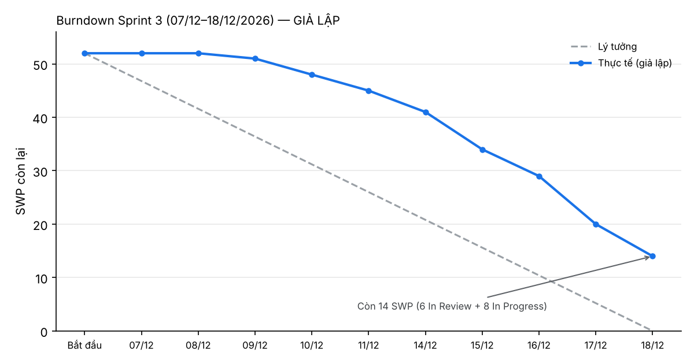

# progress-report — Sprint 3 (07/12–18/12/2026)

> ⚠ **Báo cáo giả lập.** Dự án chưa chạy thật. Trạng thái, ngày hoàn thành và burndown là kịch bản do AI đề xuất, PL duyệt ngày 2026-10-23 (dữ liệu: `lab5/sim_sprint3.json`). Kế hoạch sprint theo giả định A-06 trong PREMISE.md.
> Thời điểm báo cáo: cuối ngày 18/12/2026. Project: https://github.com/users/minhdt-0293/projects/2 (lọc Iteration = Sprint 3).

## 1. Tóm tắt

| Chỉ số | Giá trị |
|---|---|
| Cam kết Sprint 3 | 52 SWP · 14 task · 208 h |
| Hoàn thành (Done) | **38 SWP (73%)** · 152 h |
| Chưa xong, chuyển Sprint 4 | 14 SWP: 6 In Review, 8 In Progress |
| Lũy kế Sprint 1–3 | 131 / 629 SWP (20%) |
| Blocked (完納奨励金, E09-06..12) | 47 SWP — chờ khách trả lời Q-01 / Q-05 / Q-06 (PREMISE H-02) |
| Dự báo hoàn thành phần không Blocked | Sprint 15 (kết thúc 04/06/2027), nếu velocity giữ 38 SWP/sprint |

**Mục tiêu sprint** (giả lập): xong DB + hàm của tư cách tham gia (E03), đính kèm chứng từ lot (E04-06), bảo vệ API bằng AAL2 (E02-02b), và phần version tỷ lệ của 完納奨励金 không phụ thuộc công thức (E09-02..04).
Kết quả: đạt phần E03 (trừ màn P002), E04-06 và E09-02..04. Chưa đạt: E02-02b và màn P002 vùng B/C/D.

## 2. Trạng thái task trong sprint

| Issue | Task | Epic | Owner (giả định) | SWP | Status | Ngày xong / ghi chú |
|---|---|---|---|---|---|---|
| #90 | E05-06a Đặc tả hàm: cancel_trade (Function_List LAB-4: chưa đặc tả) | E05 | PL | 1 | Done | 09/12 |
| #69 | E04-04a Đặc tả hàm: record_evaluation, publish_lot (Function_List LAB-4: chưa đặc tả) | E04 | PL | 3 | Done | 10/12 |
| #122 | E09-03a Đặc tả hàm: save_rate_version (Function_List LAB-4: chưa đặc tả) | E09 | PL | 3 | Done | 11/12 |
| #46 | E03-03 Tạm ngừng tư cách (1 người) | E03 | BE-3 | 4 | Done | 14/12 |
| #56 | E03-06b Hiện thực + test | E03 | BE-3 | 3 | Done | 15/12 |
| #120 | E09-02 Version tỷ lệ: DB và quota 4 lần / năm | E09 | BE-2 | 4 | Done | 15/12 |
| #75 | E04-06 Đính kèm chứng từ (Storage) | E04 | BE-1 | 5 | Done | 16/12 |
| #45 | E03-02b Hiện thực + test | E03 | BE-3 | 5 | Done | 17/12 |
| #92 | E05-07 Danh sách / chi tiết giao dịch T001 / T003 | E05 | FE-2 | 4 | Done | 17/12 |
| #123 | E09-03b Hiện thực + test | E09 | BE-2 | 3 | Done | 18/12 |
| #124 | E09-04 Duyệt version tỷ lệ | E09 | BE-2 | 3 | Done | 18/12 |
| #34 | E02-02b Middleware chặn API khi chưa AAL2 (CS-03) | E02 | BE-1 | 5 | In Review | Reviewer yêu cầu bổ sung unit test; xong đầu Sprint 4 |
| #85 | E05-04a Đặc tả hàm: participation_usage (Function_List LAB-4: chưa đặc tả) | E05 | PL | 1 | In Review | Đặc tả xong, chờ review (DoD 6); xong đầu Sprint 4 |
| #61 | E03-08c P002 vùng B / C / D: tư cách, lịch sử, dialog yêu cầu | E03 | FE-2 | 8 | In Progress | FE lớn hơn ước lượng: dialog yêu cầu cần thêm trạng thái lỗi. Còn khoảng 50% |

Theo người (SWP xong / cam kết): BE-1 5/10 · BE-2 10/10 · BE-3 12/12 · FE-2 4/12 · PL 7/8. QA-1 và INF-1 không có task trong Sprint 3.

## 3. Burndown

| Ngày | 07/12 | 08/12 | 09/12 | 10/12 | 11/12 | 14/12 | 15/12 | 16/12 | 17/12 | 18/12 |
|---|---|---|---|---|---|---|---|---|---|---|
| SWP còn lại | 52 | 52 | 51 | 48 | 45 | 41 | 34 | 29 | 20 | 14 |

Đọc biểu đồ:
- Tuần 1 gần như đi ngang (52 → 45): chỉ xong 3 task đặc tả (SPEC). Task BE / DB phải chờ đặc tả xong mới bắt đầu.
- Tuần 2 dốc xuống, 31 SWP xong trong 5 ngày. Riêng 2 ngày cuối xong 15 SWP, nên ít thời gian review.
- Kết thúc còn 14 SWP. Nguyên nhân chính là 1 task FE 8 SWP (E03-08c) chưa xong, chiếm hơn nửa phần còn lại.

## 4. Rủi ro trễ và hành động

| # | Rủi ro | Dấu hiệu (giả lập) | Ảnh hưởng | Hành động | Người | Hạn |
|---|---|---|---|---|---|---|
| PR-01 | 完納奨励金 còn Blocked (47 SWP) | Chưa có trả lời Q-01 / Q-05 / Q-06 sau 3 sprint | Epic E09 trễ; nghiệm thu FR-INC-01 bằng test vector (C.3) không làm được. Cần thêm khoảng 2 sprint sau khi có trả lời | Nhắc khách bằng Backlog, nêu hạn trả lời. Nếu quá hạn: đề xuất khách ký giả định Q-05 / Q-06 để làm trước, chấp nhận sửa sau | PL | 04/01/2027 (đầu Sprint 5) |
| PR-02 | Velocity thấp hơn kế hoạch | Sprint 3 đạt 38/52 SWP (73%) | Phần không Blocked xong ở Sprint 15 (04/06/2027) thay vì Sprint 12 (23/04/2027). Cộng E09 thì sát go-live 30/07/2027 của WBS LAB-1, ít thời gian cho UAT và chuyển đổi dữ liệu (R-08 LAB-1) | Theo dõi thêm Sprint 4–5 trước khi kết luận. Đối chiếu giờ thực tế với 4 h/SWP (A-05) ở LAB-6 | PL | Cuối Sprint 5 |
| PR-03 | Task lớn dồn cuối sprint | 8 / 11 task xong từ 14/12; E03-08c 8 SWP chưa xong | Review gấp, dễ lọt lỗi | Tách task ≥ 8 SWP khi lập kế hoạch; gửi review từng phần từ giữa sprint | PL, FE-2 | Lập kế hoạch Sprint 4 |
| PR-04 | Tải không đều giữa các người | BE-2 / BE-3 có việc đến Sprint 11–12; QA-1 không có task ở Sprint 1–4, INF-1 không có ở Sprint 3–4 | BE-2 / BE-3 thành đường găng; QA vào muộn nên lỗi phát hiện muộn | Đưa QA-1 viết test case sớm từ spec; cân nhắc chuyển một phần BE của BE-3 cho BE-1 | PL | Lập kế hoạch Sprint 4 |
| PR-05 | Sprint 4 rơi vào kỳ nghỉ cuối năm (giả định) | Sprint 4 = 21/12/2026–01/01/2027, kế hoạch 63 SWP + 14 SWP chuyển sang | Không đạt cam kết Sprint 4 nếu giữ nguyên | Giảm cam kết Sprint 4; xác nhận lịch nghỉ của team và khách | PL | 18/12/2026 |

Việc cần khách (桜水産市場) làm: trả lời Q-01 / Q-05 / Q-06 (công thức và test vector 完納奨励金) trước 04/01/2027.
